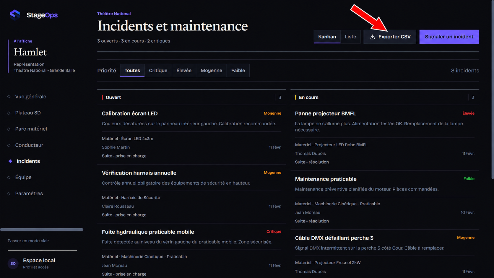

# Export CSV opérationnel

La fonctionnalité permet au régisseur de sortir l’état courant du parc matériel et du registre d’incidents dans un fichier exploitable avec Excel, LibreOffice ou Google Sheets.

## Où trouver l’export

- **Parc matériel** : bouton `Exporter CSV` dans l’en-tête de la page.
- **Incidents et maintenance** : bouton `Exporter CSV` dans l’en-tête de la page.
- **Paramètres > Export & Données** : accès aux deux exports au même endroit.

Les exports utilisent le workspace opérationnel partagé. Un incident ou un équipement ajouté dans l’application est donc présent dans le fichier sans rechargement ni jeu de données séparé.



## Colonnes

### Inventaire

`Identifiant`, `Nom`, `Catégorie`, `État`, `Localisation`, `Dernier contrôle`.

### Incidents

`Identifiant`, `Titre`, `Priorité`, `Statut`, `Équipement`, `Auteur`, `Horodatage`.

## Règles techniques

- encodage UTF-8 avec BOM pour conserver les accents dans les tableurs ;
- séparateur `;`, adapté aux configurations françaises d’Excel ;
- valeurs contenant un séparateur, un guillemet ou un saut de ligne correctement échappées ;
- textes commençant par `=`, `+`, `-` ou `@` neutralisés pour éviter l’exécution d’une formule ;
- nom de fichier composé du projet, du type de données et de la date, par exemple `theatre-national_inventaire_2026-10-05.csv`.

## Démonstration en 90 secondes

1. Ouvrir **Parc matériel** et montrer un équipement récemment ajouté ou modifié.
2. Cliquer sur **Exporter CSV** et ouvrir le fichier téléchargé.
3. Vérifier le nom, l’état et la localisation de cet équipement dans le tableur.
4. Ouvrir **Incidents et maintenance** et montrer un incident lié à cet équipement.
5. Cliquer sur **Exporter CSV**, puis vérifier dans le second fichier le titre, la priorité, le statut, l’équipement et l’auteur.

Phrase de présentation :

> « StageOps transforme l’état opérationnel vu dans l’application en un registre partageable en un clic. Les données terrain restent lisibles dans les outils déjà utilisés par l’équipe, sans ressaisie et sans perdre les accents. »

## Vérification

Depuis `StageOps_Web` :

```powershell
npm run test
npm run lint
npm run build
```

Les tests couvrent l’encodage, l’échappement, la correspondance incident-équipement, la protection contre les formules et le nommage du fichier.

## Limites actuelles

- l’export porte sur tout le workspace courant, pas seulement sur les filtres affichés ;
- il n’inclut pas les photos d’incident ;
- les exports PDF certifiés et la génération côté serveur restent hors périmètre.

## Traçabilité

- User story : [StageOps #21](https://github.com/StageOps-EIP/StageOps/issues/21)
- Epic : [StageOps #12](https://github.com/StageOps-EIP/StageOps/issues/12)
- Wiki : page `Feature Web — Export CSV opérationnel`
